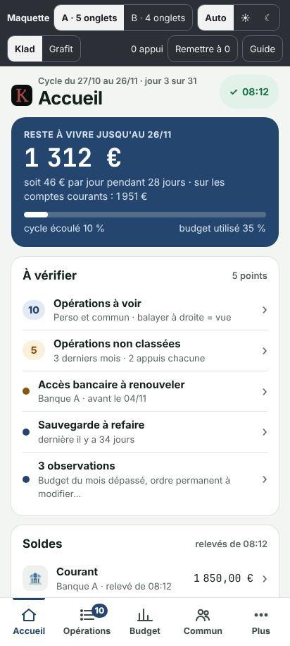
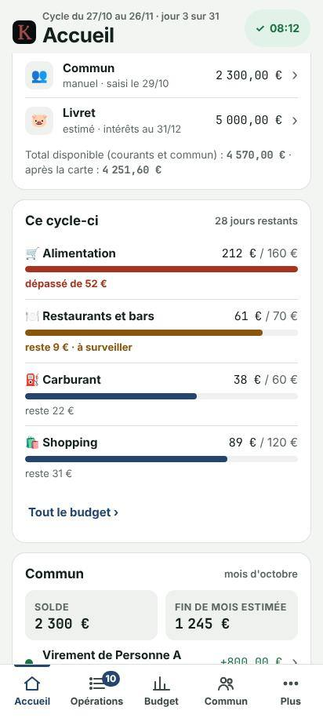
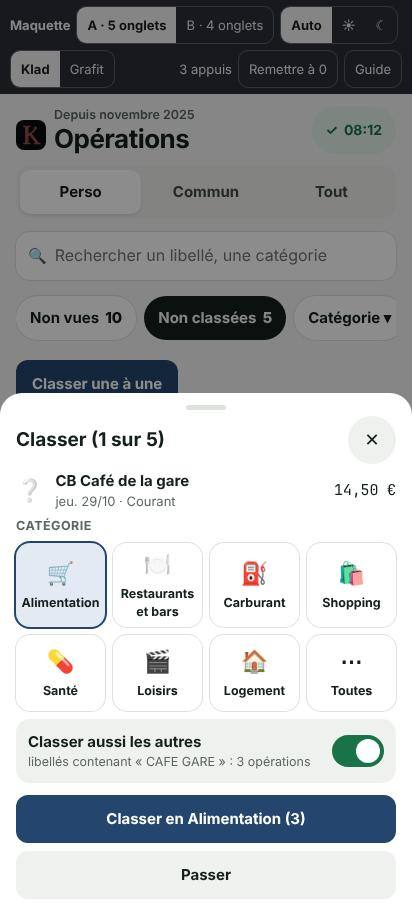
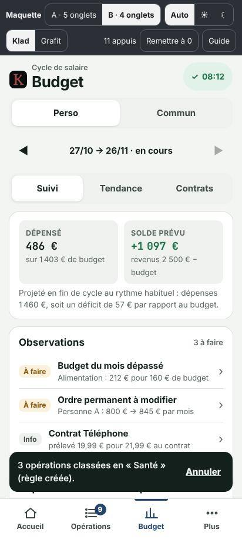
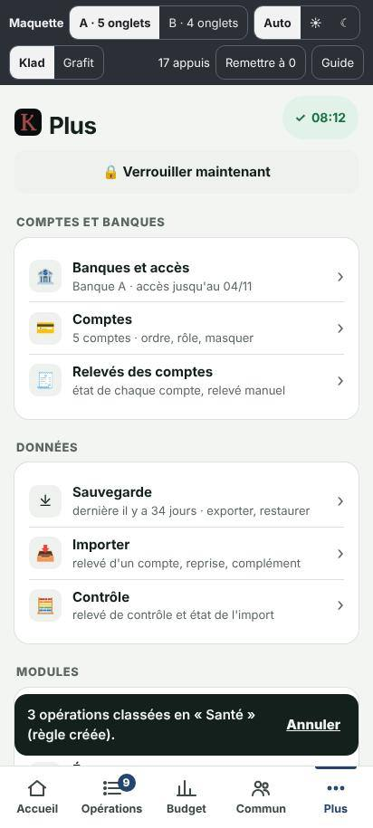
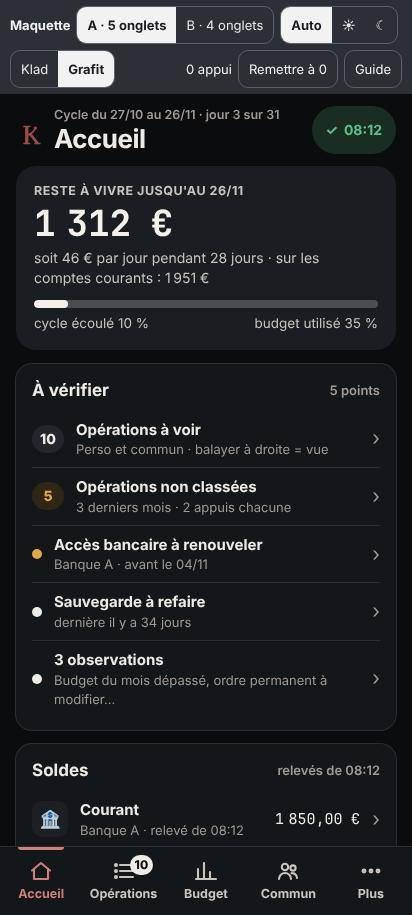
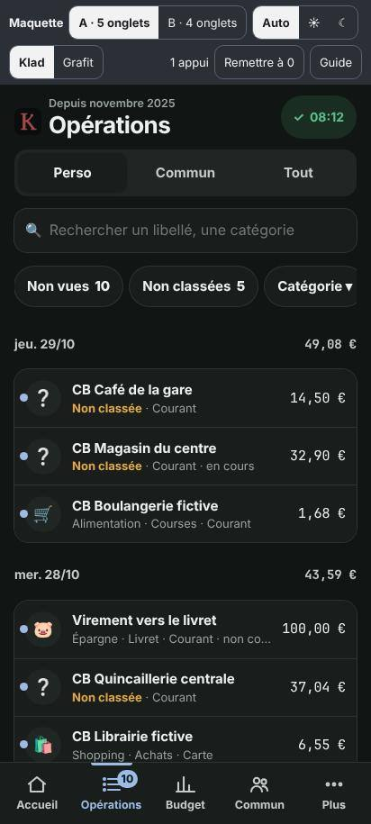

# Nouvelle organisation de Klad (proposition)

Suite de [`audit.md`](audit.md). Deux variantes, montrées dans la maquette (`site/maquette/`, bouton « A · 5 onglets /
B · 4 onglets »). **Recommandation : variante A.** Rien n'est encore modifié dans l'appli : tout ceci attend la validation
du propriétaire ; le découpage en lots est dans [`plan.md`](plan.md).

Principes :

1. **L'essentiel sans geste** : ce qu'on regarde tous les jours tient sur le premier écran de l'Accueil.
2. **Une seule place par fonction** : plus de doublon entre onglets, en-tête et Plus.
3. **Consulter d'abord, régler ensuite** : les paramètres quittent les écrans de résultats (sous-vue « Paramètres » ou Plus › Réglages).
4. **Écrans courts** : 1,5 écran au plus par vue ; au-delà, des sous-vues (boutons en haut de l'écran) plutôt que des sections repliées en bas.
5. **Aucun calcul ne change** : on déplace l'affichage, pas les chiffres.

## 1. Barre du bas

### Variante A — 5 onglets (recommandée)

| Onglet | Rôle | Contenu |
|---|---|---|
| **Accueil** | l'essentiel du jour | voir § 2 |
| **Opérations** | traiter et chercher | Perso · Commun · Tout ; recherche visible ; Non vues, Non classées, Internes, À rapprocher, Catégorie, Compte, Période ; « Trier une à une » ; liste par jour ; détail ; volet Classer |
| **Budget** | le cycle de salaire | ◀ cycle ▶ ; sous-vues **Suivi** (dépensé, solde prévu, observations, postes dépassés d'abord, charges fixes, revenus ; mode « Budget » pour modifier) · **Tendance** · **Contrats** (contrats et échéances) |
| **Commun** | le compte commun du mois | ◀ mois ▶ ; sous-vues **Ce mois** (solde, fin de mois, marge réelle, virements reçus, à mettre en place, prélèvements à venir, budget du commun) · **Trésorerie** (12 mois, appels de fonds, d'où vient le solde) · **Équilibre** (qui doit combien à qui, simulation, détails) |
| **Plus** | tout le reste, rangé | page entière en 6 groupes (§ 3) |

Largeur d'un onglet : 82 dp sur un téléphone de 412 dp (au-dessus des 48 dp demandés ; Android admet 5 onglets au plus).

### Variante B — 4 onglets

| Onglet | Différence avec A |
|---|---|
| Accueil | identique (la carte « Commun » ouvre Budget › Commun) |
| Opérations | identique |
| **Budget** | sélecteur **Perso · Commun** en haut ; Perso : Suivi · Tendance · Contrats ; Commun : Ce mois · Trésorerie · Budget |
| Plus | l'**Équilibre** passe dans Plus › Modules |

Avantages de B : un onglet de moins, boutons plus larges (103 dp), habitude du sélecteur Perso / Commun de l'ancienne
version. Inconvénients : les tâches mensuelles du commun prennent 1 appui de plus, l'équilibre s'éloigne du commun,
et l'onglet Budget porte deux logiques de période (cycle de salaire et mois civil).

**Pourquoi A** : le commun a ses propres tâches chaque mois (virements reçus, ordres à modifier, trésorerie, équilibre),
sa propre période (le mois) et ses propres personnes ; il mérite son onglet, comme dans l'ancienne version. L'Accueil en
donne déjà le résumé, donc l'onglet Commun ne sert qu'au détail.

## 2. Accueil = tableau de bord

Dans l'ordre (premier écran : reste à vivre, « À vérifier » et le début des soldes ; 2,5 écrans en tout, contre 4,7
aujourd'hui pour l'onglet Budget, et tout y est à 0 appui) :

1. **Reste à vivre** jusqu'à la fin du cycle (grand chiffre), soit N € par jour, valeur « sur les comptes courants »,
   barre du cycle écoulé et du budget utilisé. Appui : le détail actuel (base − charges fixes = marge − variable).
2. **À vérifier** (un seul bloc, une ligne par point, compteur à gauche, 56 dp) : opérations à voir (perso et commun),
   non classées, accès bancaire à renouveler, sauvegarde, mise à jour, comptes à réassocier, observations à faire,
   bilan du cycle précédent (5 premiers jours d'un cycle), prélèvements à rapprocher. Chaque ligne mène à l'écran concerné
   (comme aujourd'hui). Bloc masqué s'il n'y a rien.
3. **Soldes** en liste verticale : chaque compte (libellé, source et heure du relevé, solde ou « débiteur »), la carte à
   débit différé avec « à prélever le … », le livret estimé ; total disponible et total après la carte. Appui : les
   opérations du compte.
4. **Ce cycle-ci** (reprise du « Ce mois-ci » de l'ancienne version) : 4 postes, dépassés et à surveiller d'abord, barre,
   « dépassé de … » ou « reste … », jours restants, « Tout le budget › ».
5. **Commun** en un coup d'œil : solde, fin de mois estimée, virements reçus ou attendus, ordre à mettre en place.
6. **Prochaines échéances** (31 jours) : 4 lignes (date, libellé, perso ou commun, montant), « Toutes les échéances › ».
7. **Actions rapides** : Synchroniser, Trier les opérations, Sauvegarder, Verrouiller.

Ce qui quitte l'ancien haut de Budget : la grande carte « Total des comptes courants » devient la ligne « Total
disponible » des soldes ; les cartes horizontales deviennent la liste ; « N opérations à voir » rejoint « À vérifier ».

## 3. Plus réorganisé

Page entière (onglet), plus un volet. En tête : **Verrouiller maintenant**. Puis 6 groupes nommés :

| Groupe | Entrées | Contenu |
|---|---|---|
| **Comptes et banques** | Banques et accès · Comptes · Relevés des comptes | connexions, renouvellement, clé Enable Banking (sous « Avancé ») ; liste et fiche des comptes ; état de chaque compte et relevé manuel |
| **Données** | Sauvegarde · Importer · Contrôle | export chiffré et restauration ; relevé d'un compte, reprise de l'ancienne version, complément ; relevé de contrôle et état de l'import |
| **Modules** | Impôts · Épargne · Lien Grafit (+ Équilibre en variante B) | écrans en sous-vues (Résumé, détails, Paramètres) |
| **Extras** | Mail et Claude | réglages, clés, désactivés par défaut |
| **Réglages** | Affichage · Verrou · Classement · Budget | thème, mode démo ; code, empreinte, tout effacer ; catégories et règles ; cycle de salaire, base de calcul, personnes du commun (prépare le Lot 9c) |
| **Aide et à propos** | Version et mise à jour · Journal | version, recherche et installation ; journal anonyme, copier, vider |

Ce qui sort de Plus : Synchroniser (pastille de l'en-tête et action rapide), Thème (Réglages › Affichage), Observations
(Accueil et Budget › Suivi), « Relevés et sauvegarde » (coupé en deux : Relevés des comptes, Sauvegarde).

## 4. Place de chaque fonction

Appuis depuis l'Accueil (0.9.4 : depuis le haut de l'onglet Budget). « + n écr. » = écrans à faire défiler.

| Fonction | Place aujourd'hui | Nouvelle place (A) | Appuis avant → après | Ce qui disparaît ou fusionne |
|---|---|---|---|---|
| Reste à vivre | Budget, sous « À vérifier » | Accueil, en tête | 0 + 0,3 à 1 écr. → 0 | — |
| Soldes | Budget, grande carte et cartes horizontales | Accueil › Soldes | 0 (+ glissement) → 0 | grande carte et cartes fusionnent en une liste |
| Opérations à voir | Budget (carte) | Accueil › À vérifier ; Opérations › Non vues | 1 → 1 | carte « à voir » fusionne dans « À vérifier » |
| Non classées | Budget › À vérifier | idem ; « Trier une à une » | 1 + 3 par opération → 1 + 1 + 2 par opération | — |
| À rapprocher | Budget › À vérifier | idem | 1 → 1 | — |
| Synchroniser | pastille, Plus, Relevés | pastille, action rapide, Relevés des comptes | 1 → 1 | entrée de Plus retirée |
| Thème | en-tête, Plus, Affichage | Plus › Réglages › Affichage | 1 → 3 | icône d'en-tête et entrée de Plus retirées (à valider) |
| Budget du cycle | Budget › Budget mensuel | Accueil › Ce cycle-ci ; Budget › Suivi | 0 + 1,2 écr. → 0 | — |
| Postes dépassés | Budget, sections à ouvrir | Accueil ; Budget › Suivi, en premier | 0 + 1,2 écr. + 1 à 4 → 0 | « voir les N ▾ » par section remplacé par la liste triée |
| Observations | Budget (replié), Plus › Observations | Accueil › À vérifier ; Budget › Suivi | 1,3 écr. + 1 → 1 | entrée de Plus retirée |
| Tendance | Budget, 3,2 écr. | Budget › Tendance | 0 + 3,2 écr. → 2 | — |
| Contrats et échéances | Budget, 4 écr. + 1 | Accueil › Prochaines échéances ; Budget › Contrats | 4 écr. + 1 → 0 / 2 | — |
| Budget du poste, ajout | Budget, mode « Budget » | Budget › Suivi › Modifier le budget | 1,2 écr. + 2 → 2 | — |
| Base de calcul | Budget, mode « Budget », en bas | Budget, mode « Budget » ; rappel dans Plus › Réglages › Budget | inchangé | — |
| Bilan du cycle passé | Budget › ◀ | Budget › ◀ ; ligne « À vérifier » au changement de cycle | 1,2 écr. + 1 → 2 (ou 1) | — |
| Catégories, règles | bas de Budget, bas de Commun, Plus › Classement | Plus › Réglages › Classement | 2 → 2 | les deux sections du bas disparaissent |
| Commun : solde, fin de mois | onglet Commun | Accueil › Commun ; Commun › Ce mois | 1 → 0 | — |
| Virements reçus, à mettre en place | Commun, 1,1 écr. | Accueil › Commun ; Commun › Ce mois | 1 + 1,1 écr. → 0 / 1 | — |
| Ordres permanents | Commun, 1,1 écr. + 1 | Commun › Ce mois › Modifier les ordres | 2 + 1,1 écr. → 2 | — |
| Marge réelle | Commun | Commun › Ce mois | 1 → 1 | — |
| Trésorerie 12 mois | Commun, 2,1 écr. + 1 | Commun › Trésorerie | 2 + 2,1 écr. → 2 | — |
| Appels de fonds, d'où vient le solde | Commun, repliés | Commun › Trésorerie | 2 + 2 écr. → 2 | — |
| Budget du commun | Commun, 2,5 écr. | Commun › Ce mois (bas) | 1 + 2,5 écr. → 1 + 1 écr. | sélecteur Perso / Commun de Budget retiré |
| Équilibre | Plus › Équilibre | Commun › Équilibre (B : Plus › Modules) | 2 → 2 | — |
| Impôts | Plus › Impôts (11,8 écr.) | Plus › Modules › Impôts, sous-vues | 2 → 2 | — |
| Épargne, livret | Plus › Épargne ; livret depuis sa carte | Plus › Modules › Épargne ; livret depuis Accueil › Soldes | 2 → 2 | — |
| Lien Grafit | Plus › Modules (défilement) | Plus › Modules › Lien Grafit | 2 + défil. → 2 | « Modules » devient un vrai groupe |
| Extras (mail, Claude) | Plus › Extras (défilement) | Plus › Extras | 2 + défil. → 2 | — |
| Banques et accès, renouveler | Plus, À vérifier | Plus › Comptes et banques ; À vérifier | 2 / 3 → 2 / 3 | — |
| Comptes, fiche | Plus › Comptes | Plus › Comptes et banques › Comptes | 2 / 3 → 2 / 3 | — |
| Relevés des comptes, relevé manuel | Plus › Relevés et sauvegarde | Plus › Comptes et banques › Relevés des comptes ; Plus › Données › Importer | 3 + 1 écr. → 3 | écran « Relevés et sauvegarde » coupé en deux |
| Sauvegarde | Plus › Relevés et sauvegarde (bas) ; À vérifier | Plus › Données › Sauvegarde ; À vérifier ; action rapide | 3 + 1,3 écr. → 2 / 3 | — |
| Import de reprise, complément | Plus › Import de reprise ; Plus › Classement | Plus › Données › Importer | 2 → 3 | entrée de premier niveau retirée (rare, et finie après la bascule 1.0) |
| Contrôle | Plus › Contrôle (défilement) | Plus › Données › Contrôle | 2 + défil. → 2 | — |
| Export | Sauvegarde (chiffrée), Contrôle (en clair) | idem, dans le groupe Données | — | « Export » n'est pas une entrée à part : il est dans Sauvegarde et Contrôle |
| Affichage, mode démo | Plus › Affichage | Plus › Réglages › Affichage | 2 → 2 | — |
| Verrou (code, empreinte, effacer) | Plus › Verrou (défilement) | Plus › Réglages › Verrou | 2 + défil. → 2 | — |
| Verrouiller | Plus, bas du volet | Accueil › action rapide ; en tête de Plus | 2 + défil. → 1 / 2 | — |
| Version, mise à jour | Plus › À propos (défilement) ; À vérifier | Plus › Aide › Version et mise à jour ; À vérifier | 3 + défil. → 3 / 2 | — |
| Journal | Plus › Journal (défilement) | Plus › Aide › Journal | 3 + défil. → 3 | — |
| Détail d'une opération | volet | page (avec Retour) | 2 → 2 | — |
| Classer | volet | volet (inchangé, + mode tri) | 2 → 2 | — |

## 5. Comparaison des deux variantes

| Critère | A · 5 onglets | B · 4 onglets |
|---|---|---|
| Tâches quotidiennes | identiques | identiques |
| Commun (virements, trésorerie) | 1 à 2 appuis | 2 à 3 appuis |
| Équilibre | 2 (Commun) | 2 + 1 écr. (Plus) |
| Largeur d'un onglet | 82 dp | 103 dp |
| Habitudes de l'ancienne version | onglet Commun gardé | sélecteur Perso / Commun gardé |
| Clarté des périodes | une période par onglet (cycle ou mois) | deux périodes dans Budget |
| Travail de développement | un peu plus (onglet Commun refait) | un peu moins |

## 6. Lexique proposé

| Aujourd'hui | Proposé |
|---|---|
| Relevés et sauvegarde | Relevés des comptes (Comptes et banques) et Sauvegarde (Données) |
| Import de reprise | Importer › Reprise de l'ancienne version |
| Modules (seulement Grafit) | Modules : Impôts, Épargne, Lien Grafit |
| Observations et recommandations / Observations / À faire | Observations (titre), « à faire » (état) |
| Classement (réglage) | Classement (réglage) ; « Classer » reste l'action |
| Total des comptes courants (incluant le commun) | Total disponible (courants et commun) |
| Balance négative | balance déficitaire |
| Personne A moins 3 120 € | abattement de 3 120 € |

## 7. Apparence

- Couleurs AA : texte secondaire `#5b6661` (5,97:1 sur blanc), crédits `#1a7347`, polices de 12 px au moins, zone d'appui de 48 dp.
- Palette « Grafit » proposée en option (maquette) : chrome noir `#0A0C0E`, rouge `#9E4A4A` réservé au logo et à l'onglet
  actif, couleurs de sens inchangées et toujours doublées d'un mot (« dépassé », « débiteur »).
- Les polices embarquées, les thèmes Auto / Clair / Sombre et la réduction des animations restent.

## 8. Captures de la maquette

| Variante A · Accueil | Accueil (suite) | Trier une à une | B · Budget |
|---|---|---|---|
|  |  |  |  |

| A · Plus | A · Commun | Palette Grafit, sombre | Opérations, sombre |
|---|---|---|---|
|  |  |  |  |
